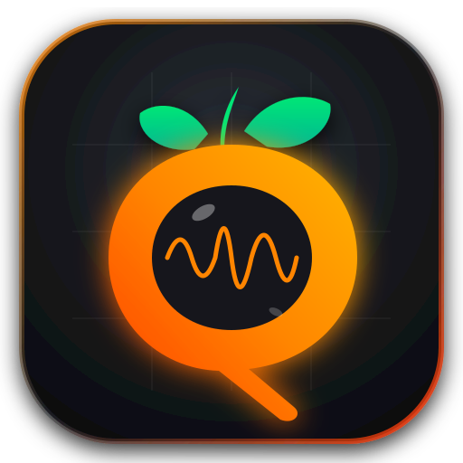
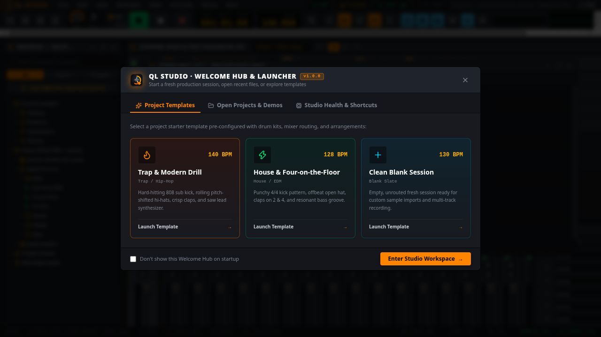

<p align="center">
  
</p>

<h1 align="center">Ql Studio</h1>

<p align="center">
  <b>High-Performance Next-Generation Digital Audio Workstation (DAW) & Desktop Music Production Suite</b><br>
  Engineered with React 19, Tailwind CSS v4, HTML5 Canvas, and Tauri v2 (Rust Real-Time Audio Core).
</p>

<p align="center">
  <a href="https://github.com/SovereignForm/Ql-Studio/stargazers"></a>
  <a href="https://github.com/SovereignForm/Ql-Studio/releases"></a>
  <a href="#-license"></a>
</p>

<p align="center">
  
  
  
  
  
  
  
</p>

---

## 🎬 Video & Visual Walkthrough

<p align="center">
  <a href="https://github.com/SovereignForm/Ql-Studio/releases">
    
  </a>
</p>

> 🎥 **Interactive DAW Feature Showcase**:
> * **[Watch Quickstart Demo Video & Workflow Tutorial (YouTube / Video Hub)](https://github.com/SovereignForm/Ql-Studio/releases)**
> * Live Multi-Track Arranging with Interactive Bezier Automation Curves
> * Channel Rack Step Sequencer & PolyBLEP Synthesizer with Moog-Style Resonant Filter
> * 64-Insert Real-Time Acyclic Routing Mixer with Zero-Latency DSP Plugins

---

## ⚡ Key Highlights & Capabilities

### 🎚️ Interactive Bezier Automation Curves (FL-Style Tension Handles)
* **Smooth Mathematical Interpolation:** Spline-accurate quadratic Bezier tension curves ($t' = t^{\exp(-2.2 \times \text{tension})}$) with dynamic tension range from `-1.0` (exponential plunge) to `+1.0` (logarithmic ramp).
* **Direct Timeline Manipulation:**
  * **Double-click:** Insert new automation point at precise timeline tick and value.
  * **Right-click:** Delete point instantly with automatic curve recalculation.
  * **Middle tension handle:** Drag up or down to bend and shape the modulation curve.
* **Modulation Target Selectors:** Control Master / Insert 1..64 faders, Channel volume, Channel pan, and resonant filter cutoffs in real time during playback.

---

### 🎹 PolyBLEP Synthesizer & Interactive ADSR Envelope Inspector
* **Studio Sound Engine:** Built-in multi-mode oscillator synthesizer supporting Band-Limited PolyBLEP Sawtooth, Square (Pulse Width), Triangle, Sine, and White Noise.
* **Interactive SVG ADSR Visualizer:** Real-time visual envelope editor for Attack, Decay, Sustain level, and Release time with live stage handles.
* **Analog Ladder Filter:** 4-Pole Moog-style resonant filter (20 Hz – 20,000 Hz) with self-oscillation resonance Q (0.1 – 18.0) and FM phase modulation depth.
* **Instant Audition Presets:** One-click presets including *"808 Deep Sub Bass"*, *"Acid 303 Lead"*, *"Lush Poly FM Pad"*, *"Punchy Kick"*, and *"Chiptune Pluck"* with live virtual piano auditioning.

---

### 🏛️ Built-In Studio DSP FX Suite (Rust Audio Core)
1. **Lush Algorithmic Studio Reverb:** Schroeder-Moorer diffusion matrix with 4 parallel feedback comb filters and 2 series all-pass diffusion stages.
2. **Tempo-Synced Stereo Ping-Pong Delay:** Cross-feedback echo alternating between left and right channels with high-frequency absorption damping.
3. **Analog Tube Saturation & Overdrive:** Asymmetric non-linear transfer function modeling triode tube clipping and dynamic harmonic tilt.
4. **PolyFM Filter Matrix:** 24dB steep analog resonant low-pass / band-pass / high-pass ladder circuit.

---

### 🔌 VST3 & CLAP Third-Party Plugin Hosting & Dedicated Popout Native Windows
* **Cross-Format Plugin Host (`vst3-host` & `clack-host`):** Scan standard system paths (`/usr/lib/vst3`, `~/.vst3`, `/Library/Audio/Plug-Ins/VST3`, `C:\Program Files\Common Files\VST3`) and host external third-party VST3 / CLAP synthesizers and effects (Serum, FabFilter, Vital, Kontakt, etc.).
* **Dedicated Popout Native Windows (`tauri::WebviewWindow`):** Pop out any loaded plugin into its own dedicated desktop window with native title bar, arbitrary resizing, parameter sync, and floating focus.
* **Studio Hardware-Modeled Skeuomorphic GUI Panels:**
  * **Vintage Tape Saturator:** Brushed aluminum and real wood cheeks, dual backlit analog illuminated VU needle meters with needle physics, tape speed/bias, flutter, and warm tube drive.
  * **Mastering Precision Limiter:** Dark slate chassis, high-contrast LED gain reduction bar ladder (0 to -24 dB), true-peak ISP limiter, threshold, and lookahead.
  * **303 Acid Bassline Synth:** Roland TB-303 silver faceplate, 18Hz to 10kHz low-pass cutoff, self-oscillating resonance, envelope mod, accent, and an interactive 16-key silver keyboard.
  * **Stereo Field Imager:** Real-time Lissajous vector oscilloscope / goniometer phase correlation display, 0% mono to 200% super-wide stereo field expander, and bass mono crossover.
* **Zero-Allocation Audio Thread Slots:** 10 insert slots per mixer channel processed lock-free in real time.

---

### 🎚️ WSOLA Time-Stretching & Hermite Cubic Pitch-Shifting Motor
* **Waveform Similarity Overlap-Add (WSOLA):** Artifact-free, phase-aligned time-stretching ($0.25\times$ to $4.0\times$) that preserves original pitch and formants without comb-filtering or phase cancellation.
* **Independent Pitch-Shifter:** Shift pitch up or down by $\pm 24$ semitones ($\pm 2$ full octaves) with zero duration alteration using 4-point Hermite cubic resampling combined with WSOLA phase matching.
* **Timeline Stretch Tool (`S`):** Grab the right edge of any audio clip on the Arranger to stretch its duration to match the project tempo in real time.
* **Clip Properties Inspector:** Double-click any audio clip to inspect and tweak time-stretch multipliers and semitone transposition with instant waveform recalculation.

---

### 🎙️ Live Vocal & Instrument Recording (Direct Monitoring)
* **Hardware Input Bus (`cpal`):** Direct capture from physical audio interfaces, USB microphones, and line-in devices.
* **Zero-Latency Direct FX Monitoring:** Live microphone audio is routed over a lock-free SPSC ring buffer straight into **Mixer Insert 1**, allowing the vocalist to hear their voice live with Reverb, Delay, and Parametric EQ without audible latency.
* **Timeline Clip Placement:** Captured audio is encoded into broadcast **16-bit / 48kHz Stereo WAV** (`samples/recorded_vocal_*.wav`) and automatically placed as a green audio waveform clip onto the Playlist Arranger at the exact recording tick.

---

### 🎛️ Physical Hardware MIDI Controller Integration
* **Plug-and-Play USB MIDI Engine (`midir`):** Automatically enumerates physical keyboards, synthesizers, and pad controllers.
* **Factory Controller Profiles:**
  * **Generic USB MIDI:** Note On/Off, dynamic velocity sensitivity, Pitch Bend, CC 7 (Volume), CC 10 (Pan).
  * **Akai Fire:** 4 endless rotary encoders mapped to volume, pan, low-pass filter cutoff, and resonance, plus pad matrix notes.
  * **Novation Launchkey:** InControl faders 1..8 mapped directly to Mixer Inserts 1..8 fader levels.
* **Sub-Millisecond Event Response:** Lock-free bypass routes hardware MIDI events straight to `RealTimeAudioEngine` without OS thread delay.
* **Live MIDI Activity LED:** Real-time toolbar indicator blinks amber on keypress and displays the active note (`MIDI IN: #60 C5`).

---

### 🔄 Global Deep Undo / Redo Architecture
* **Full Session State Preservation:** Captures channel configurations, pattern step notes, active clips across timeline tracks, and mixer fader/insert routings.
* **Quick Keybindings:** `Ctrl + Z` for Undo, and `Ctrl + Y` or `Ctrl + Shift + Z` for Redo.
* **Zero-Lag Synchronization:** Seamlessly synchronizes state changes between frontend state and backend Rust Kahn DAG graphs.

---

### 📜 Unlimited Multi-Track Playlist Arrangement
* **Infinite Arrangement Canvas:** Unlimited horizontal/vertical multi-track lanes (Tracks 1..32+) with individual track mute, solo, and custom color striping.
* **Pattern, Audio & Automation Clips:**
  * **Pattern Clips:** Note and step previews directly on the timeline.
  * **Audio Clips:** Waveform visualization with interactive edge resizing.
  * **Automation Clips:** Full Bezier curve automation with draggable tension control points for volume, pan, and filter sweeps.
* **Arrangement Tools:** Select (`S`), Pencil (`P`), Slice / Cut (`C`), Delete (`D`), and flexible snap-to-grid (Bar, Beat, 1/2 Step, 1/4 Step, None).

---

### 🚀 Studio Startup Splash Screen & Project Launcher Hub
* **Branded Startup Experience:** High-resolution vector logo with animated dual-gradient LED progress bar visualizing engine initialization milestones (audio driver allocation, Hermite voice engine, Kahn DAG routing matrix, VST3/CLAP discovery, and USB MIDI synchronization).
* **Welcome Hub & Template Launcher:**
  * **Genre Starter Templates:** Trap / Modern Drill (140 BPM), House / Four-on-the-Floor (128 BPM), and Clean Blank Session.
  * **Direct Project Imports:** Instant one-click open for FruityLoops `.flp` binary files and `.qlproj.json` session snapshots.
  * **Studio Hardware Health Check:** At-a-glance monitoring of audio interface sample rate, buffer size, and connected hardware MIDI keyboards.
  * **Configurable Startup Behavior:** Persistent preference to skip directly into the workstation or reopen anytime via the Toolbar `HUB` button.

---

### 🎚️ 64-Insert Kahn DAG Mixer
* **Acyclic Routing Graph:** Enforces acyclic signal routing with Kahn's topological sort.
* **Channel Strip Features:** 3-band RBJ biquad parametric EQ, stereo separation slider (-100% mono to +100% side), polarity inversion, left/right swap, and pre/post fader sends.
* **High-Cadence Peak Meters:** Stereo peak level tracking with logarithmic decay and clip indicators.

---

### ⚡ Zero-Allocation Audio Engine (Rust Core)
* Hard real-time audio thread executing exclusively with stack-allocated buffers and lock-free SPSC ring buffers (`rtrb`).
* Dedicated 4ms non-RT lookahead scheduling thread resolves patterns, slides, and swing without blocking the audio driver.
* Hardware buffer size options: `256`, `512`, `1024`, and `2048` frames (`cpal::BufferSize::Fixed`) for crackle-free stability on PipeWire, ALSA, CoreAudio, and WASAPI.

---

## 🎹 Keyboard Shortcuts

| Shortcut | Description |
| :--- | :--- |
| **`Space`** | Play / Pause Transport |
| **`F5`** | Toggle Playlist Arrangement Window |
| **`F6`** | Toggle Channel Rack & Step Sequencer |
| **`F7`** | Toggle Piano Roll Editor |
| **`Alt + F8`** | Toggle Sample & Preset Browser |
| **`F9`** | Toggle 64-Insert Mixer |
| **`F10`** | Open Audio, Vocal & Hardware MIDI Settings Modal |
| **`F11`** | Toggle Borderless Fullscreen Workstation |
| **`Ctrl + E`** | Export Pattern / Song Mixdown as WAV |
| **`Ctrl + S`** | Save Project State (`.qlproj.json`) |
| **`Ctrl + Z` / `Ctrl + Y`** | Global Deep Undo / Redo |

---

## 🚀 Building & Running Locally

### Prerequisites
- Node.js >= 20
- Rust stable (`rustup default stable`)
- **Linux:** `sudo apt install libwebkit2gtk-4.1-dev libasound2-dev libpipewire-0.3-dev librsvg2-dev`

### Development
```bash
# Clone the repository
git clone https://github.com/SovereignForm/Ql-Studio.git
cd Ql-Studio

# Install frontend dependencies
npm install

# Run Desktop DAW in developer mode
npm run tauri:dev
```

### Unit Tests
```bash
# Run Rust unit tests (DSP, VST3/CLAP hosting, MIDI, audio recording, WAV sampler)
cd src-tauri
cargo test
```

### Production Build
```bash
# Build frontend and optimized release binary
npm run build
cargo build --release --manifest-path src-tauri/Cargo.toml
```

---

## 📦 Multi-Platform Downloads

Pre-built binaries are generated automatically on release:

- 🐧 **Linux:** `.deb` (Debian, Ubuntu, Mint, Pop!_OS) & `.AppImage`
- 🪟 **Windows:** `.exe` (NSIS Installer) & `.msi` (Windows Installer)
- 🍏 **macOS:** `.dmg` (Universal binary: Apple Silicon M1/M2/M3/M4 & Intel x86_64)

👉 Visit the [Releases Page](https://github.com/SovereignForm/Ql-Studio/releases) to download the latest desktop packages.

---

## 📈 Star History

<p align="center">
  <a href="https://star-history.com/#SovereignForm/Ql-Studio&Date">
    <picture>
      <source media="(prefers-color-scheme: dark)" srcset="https://api.star-history.com/svg?repos=SovereignForm/Ql-Studio&type=Date&theme=dark" />
      <source media="(prefers-color-scheme: light)" srcset="https://api.star-history.com/svg?repos=SovereignForm/Ql-Studio&type=Date" />
      
    </picture>
  </a>
</p>

---

## 📄 License

QL Studio is licensed under the **GNU General Public License v3.0 (GPL-3.0)** with **Plugin Hosting & Dynamic Link Exceptions** allowing proprietary VST3 / CLAP plugins to load seamlessly.
